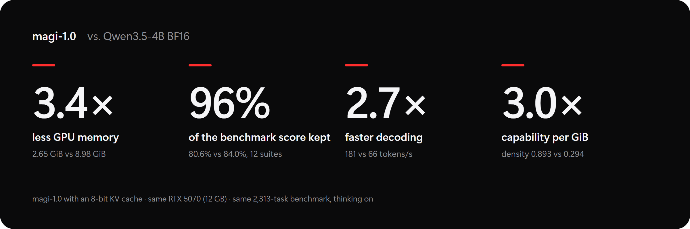
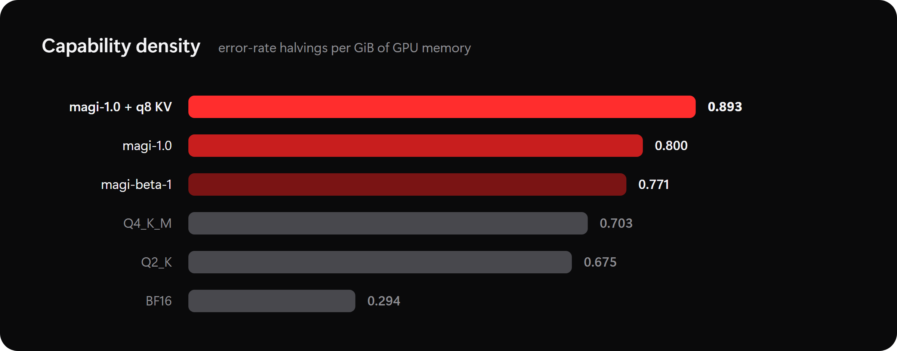

<p align="center"></p>

# magi-1.0

**Qwen3.5-4B in 1.8 GiB, with no training. The bits go where the model needs them.**

magi-1.0 is a training-free mixed-precision quantization of [Qwen/Qwen3.5-4B](https://huggingface.co/Qwen/Qwen3.5-4B) by the Qwen team, made by GEHIRNS. The weights are Qwen's own; we only chose how many bits each part of the model gets, using standard GGUF formats. It runs unmodified in llama.cpp and Ollama.

**Model:** [huggingface.co/GEHIRNS/magi-1.0](https://huggingface.co/GEHIRNS/magi-1.0) · **Paper:** [Where the Bits Go (PDF)](paper/where-the-bits-go.pdf)

<p align="center"></p>

The headline ratios are for magi-1.0 served with an 8-bit KV cache. With the default 16-bit cache, magi-1.0 needs 3.0× less GPU memory than BF16 and has 2.7× its capability per GiB.

## Results

Every model ran on the same setup:
- **Hardware:** one RTX 5070 (12 GB).
- **Benchmark:** the same 2,313 tasks across 12 suites (coding, reasoning, knowledge, math and tool calls).
- **Settings:** thinking on with a 4,096-token budget, greedy decoding, 32K context.

| Model | Benchmark score | GPU memory (GiB) | Capability per GiB | Decode speed (tok/s) |
|---|---|---|---|---|
| **magi-1.0 + 8-bit KV cache** | 80.64% | **2.65** | **0.893** | 181.4 |
| **magi-1.0** | 81.30% | 3.02 | 0.800 | 180.0 |
| magi-beta-1 | 80.65% | ≈3.07 | ≈0.771 | 181.0 |
| Qwen3.5-4B Q4_K_M (Unsloth) | 84.14% | 3.78 | 0.703 | 146.6 |
| Qwen3.5-4B Q2_K (bartowski) | 77.06% | 3.15 | 0.675 | 165.5 |
| Qwen3.5-4B BF16 | 83.96% | 8.98 | 0.294 | 66.3 |

- **Capability per GiB** = −log₂(1 − score) / GiB: how many times the error rate is halved for each gibibyte of GPU memory.
- **GPU memory** is the resident size that Ollama reports with a 32K context loaded. It does not include the CUDA context, which is about 1.05 GiB for every model. Counting it, the density ratio between magi-1.0 + 8-bit KV and BF16 falls from 3.0× to 2.4×, and the ranking stays the same.
- magi-beta-1's memory was read from Ollama's rounded display, so it is accurate only to about ±0.05 GiB.

<p align="center"></p>

**The honest trade-off:** Q4_K_M scores within 0.2 points of BF16 and 2.85 points above magi-1.0, but it needs 0.76 GiB more memory (1.13 GiB more than magi-1.0 with the 8-bit cache).
- **Accuracy matters most:** use Q4_K_M.
- **Memory is the limit:** use magi-1.0.

## How it works

1. **Measure.** We lower one kind of tensor at a time and count how often the model's top next-token choice stops matching full precision, on its own reasoning and chat. The most sensitive tensors turn out to be small: the attention value, key and output projections and the DeltaNet output projection.
2. **Allocate.** A fixed size budget is spent where the measured damage per byte is largest. The small sensitive projections and the embedding get 4.5–8.5 bits; the large FFN matrices get 3.06 bits. The average is 3.65 bits per weight.
3. **Check behaviour.** Candidates are screened on 126 reasoning tasks, 86 of which a 2-bit file fails and a 4-bit file solves. Relative to Q2_K, magi-1.0's gain comes almost entirely from fewer runaway reasoning loops: 21% of its failed tasks end in a loop, against 59% for Q2_K.

At each of three sizes, this allocation diverges less from full precision than all three random placements of the same bytes, on the divergence objective; random placements were not run on the full benchmark. Against a uniform assignment of the same formats the evidence is weaker: at the smallest size the two tie (0.4 points of divergence, within about one standard error) with the allocation using 0.04 GiB less, and at magi-1.0's size the allocation is about 1 point lower (interpolated, because the sizes differ). The details are in the [paper](paper/where-the-bits-go.pdf).

## Run it

**Ollama**, straight from Hugging Face:

```bash
ollama run hf.co/GEHIRNS/magi-1.0
```

The benchmarks used a 32K context. Inside the session run `/set parameter num_ctx 32768`, or download the `Modelfile` from the Hugging Face repo and run `ollama create magi-1.0 -f Modelfile`. To get the 8-bit KV cache, start the Ollama server with `OLLAMA_FLASH_ATTENTION=1` and `OLLAMA_KV_CACHE_TYPE=q8_0`.

**llama.cpp**, with `magi-1.0.gguf` downloaded from Hugging Face:

```bash
llama-server -m magi-1.0.gguf -c 32768 --jinja
# 8-bit KV cache (2.65 GiB):
llama-server -m magi-1.0.gguf -c 32768 --jinja --flash-attn on --cache-type-k q8_0 --cache-type-v q8_0
```

All benchmark numbers were measured without a system prompt.

## Models

| | |
|---|---|
| [GEHIRNS/magi-1.0](https://huggingface.co/GEHIRNS/magi-1.0) | recommended |
| [GEHIRNS/magi-beta-1](https://huggingface.co/GEHIRNS/magi-beta-1) | experimental: same recipe, full-attention key/value/output at Q6_K |
| [MAGI collection](https://huggingface.co/collections/GEHIRNS/magi-6adaeeaefd1d999584a8a12d) · [MAGI experimental](https://huggingface.co/collections/GEHIRNS/magi-experimental-6ad6a94511ffd4dabaa7b24a) | all releases |

## Reproduce

- **Build the models:** [`recipe/BUILD.md`](recipe/BUILD.md) rebuilds both files from Qwen3.5-4B BF16 with one `llama-quantize` call each, using the override files and importance matrix in [`recipe/`](recipe/).
- **Check a build:** `python recipe/verify_tensors.py magi-1.0.gguf recipe/magi-1.0.tensor-types.tsv` compares every tensor's type and data hash with the release. The released files were built with this kit, so a rebuild run the same way from the repository root matches them byte for byte. The builds we originally benchmarked differ from them only in two metadata strings that held local paths; all 426 tensors match.
- **Check the numbers:** [`data/`](data/) holds the data behind every table and figure, including per-task pass/fail and loop flags for the six benchmarked configurations. See [`data/README.md`](data/README.md).
- **Not released yet:** the evaluation harness, prompts, model outputs and the in-house ToolCall suite.

## Limitations

- **Scope:** one model, one runtime (Ollama 0.40.3) and one benchmark; each configuration ran the full benchmark once. Where magi-1.0 ran the 126 screening tasks twice (with either KV cache), the outputs were identical.
- **magi-beta-1 was not screened as released.** A pre-release build with the same tensor types but a different importance matrix passed the behaviour screen. On the same 126 tasks, the released file (from its full run) solves 51 of the 86 decisive tasks, one short of the screen's bar of 52, so it stays experimental.
- **Hard coding:** the largest loss against BF16 is on hard coding problems, LiveCodeBench 24.67% against 35.33%.
- **Overlap:** the 126 screening tasks are part of the benchmark. Without them, magi-1.0 still leads Q2_K, by 1.4 points instead of 4.2.
- **Loop counts** come from a compression rule that has not been checked against hand labels.
- **Leaner settings:** in the configurations tested, fewer bits on the least sensitive tensors came with more loops. In the leanest candidate screened, the FFN cuts brought two to three times as many loops (22 against 10 and 27 against 9, between builds with the same importance matrix), whichever precision the attention projections had. A longer thinking budget did not significantly improve solves. See "Limits of further compression" in the paper.

## Citation

```bibtex
@misc{gehirns2026wherethebitsgo,
  title  = {Where the Bits Go: Sensitivity-Allocated Mixed Precision for a 4B Reasoning Model on a 12 GB Consumer GPU},
  author = {{GEHIRNS}},
  year   = {2026},
  url    = {https://huggingface.co/GEHIRNS/magi-1.0}
}
```

## License

Apache-2.0, the same as Qwen3.5-4B. magi-1.0 contains the Qwen team's weights in a different mix of quantization formats. See [LICENSE](LICENSE).
